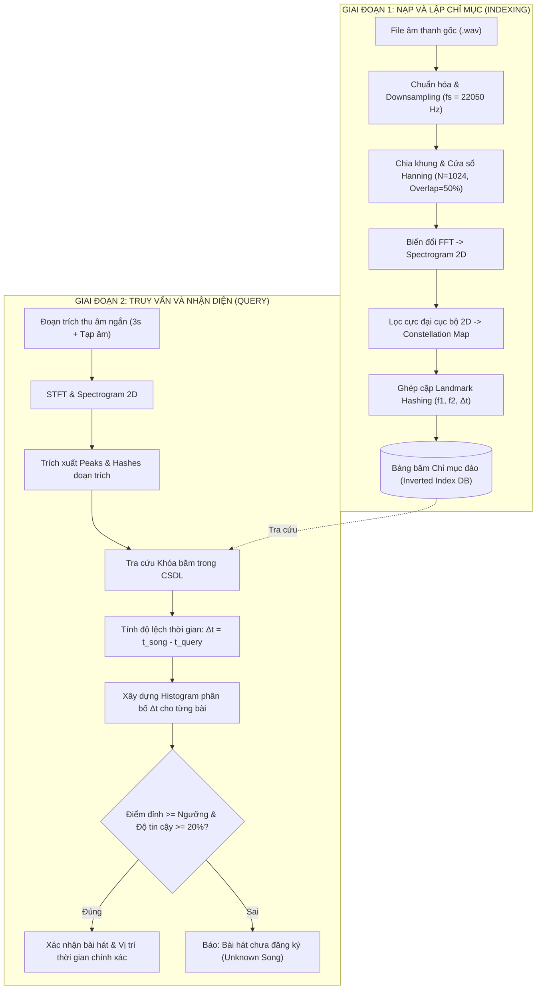

# BÁO CÁO BÀI TẬP LỚN MÔN HỌC: XỬ LÝ TÍN HIỆU SỐ (XLTHS)

---

**ĐỀ TÀI:**  
### **NGHIÊN CỨU VÀ XÂY DỰNG HỆ THỐNG NHẬN DIỆN BÀI HÁT SỐ MINI-SHAZAM DỰA TRÊN BIẾN ĐỔI FOURIER THỜI GIAN NGẮN (STFT) VÀ KỸ THUẬT LANDMARK HASHING**

* **Môn học:** Xử lý Tín hiệu Số (Digital Signal Processing - DSP)
* **Sinh viên thực hiện:** Lê Văn Thành
* **Mã sinh viên (MSV):** K25DTCN402
* **Ngành:** Kỹ thuật Điện tử - Viễn thông / Công nghệ Thông tin / Kỹ thuật Máy tính
* **Ngôn ngữ thực hiện:** Python 3 (NumPy, SciPy, Matplotlib)
* **Sản phẩm bàn giao:** Bộ mã nguồn Python hoàn chỉnh (`main_demo.py`, `fingerprint.py`, `recognizer.py`, `audio_generator.py`, `generate_plots.py`, `live_mic_recognizer.py`) và Báo cáo khoa học.

---

## MỤC LỤC

1. [CHƯƠNG 1: TỔNG QUAN VÀ ĐẶT VẤN ĐỀ](#chương-1-tổng-quan-và-đặt-vấn-đề)
   - 1.1. Bối cảnh và Tính cấp thiết của đề tài
   - 1.2. Mục tiêu nghiên cứu
   - 1.3. Phạm vi và Nhiệm vụ thực hiện
2. [CHƯƠNG 2: CƠ SỞ LÝ THUYẾT XỬ LÝ TÍN HIỆU SỐ](#chương-2-cơ-sở-lý-thuyết-xử-lý-tín-hiệu-số)
   - 2.1. Rời rạc hóa và Định lý lấy mẫu Nyquist-Shannon
   - 2.2. Biến đổi Fourier rời rạc (DFT) và Thuật toán FFT
   - 2.3. Rò rỉ phổ (Spectral Leakage) và Kỹ thuật cửa sổ (Windowing)
   - 2.4. Biến đổi Fourier thời gian ngắn (STFT) và Bản đồ phổ (Spectrogram)
   - 2.5. Thang đo Decibel (dB) và Cảm thụ âm thanh
   - 2.6. Bộ lọc cực đại cục bộ 2 chiều (2D Local Maximum Filter)
3. [CHƯƠNG 3: KIẾN TRÚC VÀ THIẾT KẾ THUẬT TOÁN HỆ THỐNG](#chương-3-kiến-trúc-và-thiết-kế-thuật-toán-hệ-thống)
   - 3.1. Sơ đồ khối tổng thể của hệ thống
   - 3.2. Thuật toán trích xuất dấu vân tay âm thanh (Audio Fingerprinting)
   - 3.3. Thuật toán ghép cặp Landmark Hashing (Shazam Algorithm)
   - 3.4. Cấu trúc Bảng băm chỉ mục đảo (Inverted Index Database)
   - 3.5. Thuật toán Đối sánh và Phân tích Histogram độ lệch thời gian
   - 3.6. Cơ chế phát hiện bài hát ngoại lai (Unknown Song Detection)
4. [CHƯƠNG 4: CÀI ĐẶT HỆ THỐNG VÀ THỰC NGHIỆM TRÊN PYTHON](#chương-4-cài-đặt-hệ-thống-và-thực-nghiệm-trên-python)
   - 4.1. Kiến trúc thư mục và Mô tả các mô-đun
   - 4.2. Kỹ thuật tổng hợp âm thanh số (Additive Synthesis & ADSR)
   - 4.3. Mô hình hóa nhiễu Gaussian trắng (AWGN)
5. [CHƯƠNG 5: KẾT QUẢ THỰC NGHIỆM VÀ PHÂN TÍCH ĐÁNH GIÁ](#chương-5-kết-quả-thực-nghiệm-và-phân-tích-đánh-giá)
   - 5.1. Phân tích đồ thị phổ Spectrogram và Bản đồ chòm sao
   - 5.2. Minh họa nguyên lý ghép cặp Landmark
   - 5.3. Khảo sát độ bền vững trước nhiễu trắng AWGN
   - 5.4. Đánh giá phân bố độ lệch thời gian trên Histogram
   - 5.5. Đánh giá độ nhạy theo thời lượng và độ trễ xử lý
6. [CHƯƠNG 6: KẾT LUẬN VÀ HƯỚNG PHÁT TRIỂN](#chương-6-kết-luận-và-hướng-phát-triển)
7. [TÀI LIỆU THAM KHẢO](#tài-liệu-tham-khảo)

---

## CHƯƠNG 1: TỔNG QUAN VÀ ĐẶT VẤN ĐỀ

### 1.1. Bối cảnh và Tính cấp thiết của đề tài
Trong thời đại bùng nổ truyền thông số, nhu cầu tìm kiếm, nhận dạng và quản lý bản quyền âm thanh ngày càng trở nên quan trọng. Một trong những ứng dụng thương mại thành công nhất của ngành Xử lý Tín hiệu Số (Digital Signal Processing - DSP) là ứng dụng **Shazam**, cho phép người dùng chỉ cần đưa điện thoại thu âm một đoạn nhạc 3 - 5 giây lẫn tạp âm ngoài môi trường (tiếng còi xe, tiếng nói chuyện) là có thể xác định chính xác tên bài hát và nghệ sĩ trình bày.

Vấn đề cốt lõi của bài toán này trong DSP là:
1. **Dung lượng khổng lồ:** Không thể so sánh từng mẫu âm thanh thô (raw waveform) trong miền thời gian vì độ phức tạp tính toán quá lớn và dữ liệu âm thanh dễ bị lệch pha, sai lệch độ trễ thời gian.
2. **Nhiễu môi trường:** Tín hiệu thu âm từ micro bị biến dạng bởi tạp âm ngẫu nhiên (nhiễu nền, nhiễu cộng tính AWGN).
3. **Bất biến với thời gian (Time-Invariance):** Đoạn trích thu âm có thể bắt đầu ở bất kỳ vị trí ngẫu nhiên nào trong bài hát mà không có tín hiệu đồng bộ ban đầu.

Do đó, việc nghiên cứu cơ sở lý thuyết DSP đằng sau thuật toán trích xuất dấu vân tay âm thanh (Audio Fingerprinting) và phân tích phổ thời gian - tần số mang ý nghĩa học thuật và thực tiễn rất lớn đối với sinh viên chuyên ngành.

### 1.2. Mục tiêu nghiên cứu
* Nắm vững và vận dụng các kiến thức cốt lõi của môn học: Rời rạc hóa tín hiệu, Định lý lấy mẫu Nyquist, Biến đổi Fourier rời rạc (DFT/FFT), Cửa sổ hóa (Windowing) để khử rò rỉ phổ, Biến đổi Fourier thời gian ngắn (STFT) và ma trận phổ 2D (Spectrogram).
* Tự thiết kế và cài đặt hệ thống nhận diện bài hát **Mini-Shazam** bằng ngôn ngữ Python mà không phụ thuộc vào các thư viện đen (black-box AI/Deep Learning), làm nổi bật bản chất toán học DSP.
* Đánh giá độ bền vững của hệ thống dưới các tác động thực tế: cắt đoạn ngẫu nhiên, nhiễu trắng Gaussian (AWGN), bài hát lạ chưa đăng ký.

### 1.3. Phạm vi và Nhiệm vụ thực hiện
* Tự xây dựng module tổng hợp âm thanh nhạc cụ chuẩn DSP (`audio_generator.py`) tạo cơ sở dữ liệu kiểm thử độc lập.
* Xây dựng module trích xuất dấu vân tay âm thanh (`fingerprint.py`) dựa trên thuật toán kinh điển của Avery Li-Chun Wang (Shazam, 2003).
* Xây dựng engine đối sánh và phân tích độ lệch thời gian (`recognizer.py`) với bảng băm chỉ mục đảo.
* Thực hiện kịch bản đánh giá toàn diện, xuất các biểu đồ trực quan khoa học phục vụ báo cáo.

---

## CHƯƠNG 2: CƠ SỞ LÝ THUYẾT XỬ LÝ TÍN HIỆU SỐ

### 2.1. Rời rạc hóa và Định lý lấy mẫu Nyquist-Shannon
Tín hiệu âm thanh liên tục trong tự nhiên $x(t)$ được chuyển đổi thành tín hiệu số $x[n]$ thông qua quá trình lấy mẫu theo chu kỳ $T_s = \frac{1}{f_s}$:
$$x[n] = x(n T_s), \quad n \in \mathbb{Z}$$

Theo **Định lý lấy mẫu Nyquist-Shannon**, để khôi phục hoàn toàn và tránh hiện tượng chồng phổ (Aliasing), tần số lấy mẫu $f_s$ phải thỏa mãn:
$$f_s \ge 2 f_{max}$$
Trong hệ thống này, ta chọn $f_s = 22050 \text{ Hz}$. Dải tần số Nyquist đạt được là $f_N = 11025 \text{ Hz}$, bao phủ toàn bộ dải tần số cơ bản và họa âm quan trọng nhất của âm nhạc và giọng nói người (vốn tập trung chủ yếu dưới 8 kHz).

### 2.2. Biến đổi Fourier rời rạc (DFT) và Thuật toán FFT
Để chuyển đổi tín hiệu từ miền thời gian sang miền tần số, ta sử dụng Biến đổi Fourier rời rạc (DFT). Với một đoạn tín hiệu gồm $N$ mẫu $x[n]$ ($0 \le n < N$):
$$X[k] = \sum_{n=0}^{N-1} x[n] \cdot e^{-j \frac{2\pi}{N} k n}, \quad k = 0, 1, \dots, N-1$$

* $X[k]$ là số phức biểu diễn biên độ và pha của thành phần tần số thứ $k$.
* Tần số vật lý tương ứng của bin thứ $k$ được tính bằng:
  $$f_k = \frac{k \cdot f_s}{N} \quad (\text{Hz})$$

Thuật toán Biến đổi Fourier nhanh (FFT - Fast Fourier Transform) tối ưu hóa độ phức tạp tính toán từ $\mathcal{O}(N^2)$ của DFT trực tiếp xuống còn $\mathcal{O}(N \log_2 N)$. Vì tín hiệu âm thanh $x[n]$ là tín hiệu thực (Real-valued signal), phổ $X[k]$ có tính chất đối xứng liên hợp Hermite: $X[N-k] = X^*[k]$. Do đó, ta chỉ cần tính toán và lưu trữ $\frac{N}{2} + 1$ bin tần số đầu tiên (sử dụng thuật toán `rfft`).

### 2.3. Rò rỉ phổ (Spectral Leakage) và Kỹ thuật cửa sổ (Windowing)
Khi cắt một đoạn tín hiệu hữu hạn $N$ mẫu bằng cách nhân với cửa sổ chữ nhật ngầm định $w_{rect}[n]$, các điểm gián đoạn ở hai đầu khung gây ra hiện tượng tán xạ năng lượng sang các tần số lân cận, gọi là **hiện tượng rò rỉ phổ (Spectral Leakage)**.

Để giảm thiểu hiện tượng này, mỗi khung tín hiệu trước khi tính FFT được nhân với một hàm cửa sổ làm trơn. Trong đề tài này, ta áp dụng **Cửa sổ Hanning (Hann Window)**:
$$w[n] = 0.5 \left(1 - \cos\left(\frac{2\pi n}{N-1}\right)\right), \quad 0 \le n < N$$

Hàm Hanning đưa biên độ ở hai mép khung về tiệm cận 0, giúp búp sóng phụ (sidelobes) của phổ giảm nhanh xuống dưới $-31 \text{ dB}$, triệt tiêu phần lớn năng lượng rò rỉ và làm cho các đỉnh tần số nốt nhạc trở nên sắc nét.

```
       Biên độ
        1.0 |              .---.
            |            /       \
            |          /           \
            |        /               \
        0.0 |_______/_________________\_______
            0                               N-1 (Mẫu n)
                     Cửa sổ Hanning w[n]
```

### 2.4. Biến đổi Fourier thời gian ngắn (STFT) và Bản đồ phổ (Spectrogram)
Tín hiệu âm nhạc là tín hiệu **không dừng (Non-stationary signal)**, nghĩa là nội dung tần số thay đổi liên tục theo thời gian. Phép biến đổi FFT toàn cục trên cả bài hát sẽ làm mất hoàn toàn thông tin về thời điểm xuất hiện của các nốt nhạc.

Để giải quyết vấn đề này, ta sử dụng **Biến đổi Fourier thời gian ngắn (STFT - Short-Time Fourier Transform)**:
1. Chia tín hiệu $x[n]$ thành nhiều khung nhỏ có độ dài $N = 1024$ mẫu ($\approx 46.4 \text{ ms}$ tại $f_s = 22050 \text{ Hz}$).
2. Các khung được dịch chuyển theo bước nhảy $H = 512$ mẫu (tương ứng độ chồng lấp $50\%$ Overlap giữa các khung liên tiếp để tránh mất mát thông tin tại mép cửa sổ).
3. Khung thứ $m$ sau khi nhân cửa sổ:
   $$x_m[n] = x[m \cdot H + n] \cdot w[n], \quad 0 \le n < N$$
4. Tính FFT cho từng khung để thu được ma trận phức 2 chiều $X(m, k)$:
   $$X(m, k) = \sum_{n=0}^{N-1} x_m[n] \cdot e^{-j \frac{2\pi}{N} k n}$$

**Bản đồ phổ biên độ (Spectrogram):**
$$S(m, k) = |X(m, k)| = \sqrt{\text{Re}^2(X(m, k)) + \text{Im}^2(X(m, k))}$$
Spectrogram biểu diễn phân bố năng lượng của tín hiệu đồng thời trên cả 2 trục: Trục hoành là Thời gian (khung $m$) và Trục tung là Tần số (bin $k$).

### 2.5. Thang đo Decibel (dB) và Cảm thụ âm thanh
Tai người cảm nhận độ to của âm thanh theo quy luật logarit (Định luật Weber-Fechner). Do đó, ma trận phổ được chuẩn hóa sang thang đo Decibel (dB):
$$S_{dB}(m, k) = 20 \log_{10} \left( S(m, k) + \epsilon \right)$$
trong đó $\epsilon = 10^{-6}$ là đại lượng bù tránh lỗi chia cho 0 hoặc $\log(0)$.

### 2.6. Bộ lọc cực đại cục bộ 2 chiều (2D Local Maximum Filter)
Để trích xuất các điểm đặc trưng nổi bật nhất của bài hát, ta tìm các điểm cực đại cục bộ trên ma trận 2D $S_{dB}(m, k)$.
Một điểm tại tọa độ $(m_0, k_0)$ được coi là một đỉnh (Peak) nếu:
1. Giá trị của nó là lớn nhất trong vùng lân cận kích thước $(W_f \times W_t)$:
   $$S_{dB}(m_0, k_0) = \max_{(k, m) \in \mathcal{N}} S_{dB}(m, k)$$
   với $\mathcal{N} = [k_0 - \lfloor W_f/2 \rfloor, k_0 + \lfloor W_f/2 \rfloor] \times [m_0 - \lfloor W_t/2 \rfloor, m_0 + \lfloor W_t/2 \rfloor]$.
2. Giá trị biên độ phải vượt qua ngưỡng năng lượng tương đối:
   $$S_{dB}(m_0, k_0) \ge S_{max} - \text{Threshold}_{rel}$$
   (với $S_{max} = \max S_{dB}$, chọn $\text{Threshold}_{rel} = 25 \text{ dB}$).

Tập hợp các đỉnh cực đại này tạo thành **Bản đồ chòm sao (Constellation Map)**:
$$\mathcal{P} = \{ (t_i, f_i) \}_{i=1}^P$$

---

## CHƯƠNG 3: KIẾN TRÚC VÀ THIẾT KẾ THUẬT TOÁN HỆ THỐNG

### 3.1. Sơ đồ khối tổng thể của hệ thống



### 3.2. Thuật toán trích xuất dấu vân tay âm thanh (Audio Fingerprinting)
Dấu vân tay âm thanh không thể chỉ dựa vào tần số đơn lẻ của từng đỉnh vì một nốt nhạc có thể xuất hiện hàng nghìn lần trong các bài hát khác nhau. Thay vào đó, thuật toán Shazam sử dụng **cấu trúc liên kết cặp điểm (Combinatorial Landmark Hashing)**.

### 3.3. Thuật toán ghép cặp Landmark Hashing
Với mỗi điểm neo (Anchor Peak) tại tọa độ thời gian $t_1$ và bin tần số $f_1$:
1. Xác định một vùng mục tiêu (Target Zone) nằm ở phía trước trục thời gian:
   $$t_1 + \Delta t_{min} \le t_2 \le t_1 + \Delta t_{max}$$
   với $\Delta t_{min} = 2$ khung ($\approx 46 \text{ ms}$) và $\Delta t_{max} = 35$ khung ($\approx 812 \text{ ms}$). Việc đặt $\Delta t_{min} \ge 2$ ngăn chặn hiện tượng ghép cặp với chính các đỉnh họa âm của cùng một nốt nhạc đang kéo dài.
2. Với mỗi đỉnh $(t_2, f_2)$ rơi vào Target Zone (lấy tối đa $K = 5$ cặp lân cận), sinh ra một khóa băm đặc trưng:
   $$\text{Hash Key} = f_1 \parallel f_2 \parallel \Delta t \quad (\text{với } \Delta t = t_2 - t_1)$$
3. Gói dữ liệu lưu trữ gồm:
   $$(\text{Hash Key}, t_1, \text{Song ID})$$

```
Tần số (Hz) ^
            |          . (Đỉnh f2, t2)
            |         /
            |        /  Vector ghép cặp: [f1 | f2 | Δt]
            |       /
            |    . (Điểm neo f1, t1)
            |    |<- Δt ->|
            +----------------------------------> Thời gian (t)
```

**Ưu điểm vượt trội của Landmark Hashing:**
* **Bất biến với độ to:** Nếu âm thanh bị vặn to hoặc nhỏ, giá trị tương đối giữa các đỉnh cực đại cục bộ không đổi.
* **Bất biến với dịch chuyển thời gian:** Khóa băm chỉ chứa $\Delta t = t_2 - t_1$, hoàn toàn không phụ thuộc vào thời điểm bài hát bắt đầu phát.
* **Bền vững trước nhiễu:** Khi có nhiễu trắng ngẫu nhiên, một số cặp điểm có thể bị phá hủy, nhưng các cặp điểm neo năng lượng cao vẫn tồn tại và ghép đúng cặp.

### 3.4. Cấu trúc Bảng băm chỉ mục đảo (Inverted Index Database)
Cơ sở dữ liệu được thiết kế theo mô hình bảng băm chỉ mục đảo (Inverted Index):
$$\mathcal{D}[\text{Hash Key}] \longrightarrow [(\text{Song ID}_1, t_{1a}), (\text{Song ID}_2, t_{1b}), \dots]$$
Thời gian tra cứu một khóa băm đạt độ phức tạp xấp xỉ $\mathcal{O}(1)$.

### 3.5. Thuật toán Đối sánh và Phân tích Histogram độ lệch thời gian
Giả sử đoạn truy vấn $q[n]$ được trích xuất từ bài hát $S^*$ bắt đầu tại giây thứ $T_{start}$ (tương ứng khung thời gian $M_{start}$).
Khi trích xuất các mã băm từ đoạn truy vấn, một cặp đỉnh neo tại thời điểm truy vấn $t_q$ sẽ có thời điểm gốc trong bài hát là:
$$t_s = t_q + M_{start}$$
Do đó, hiệu số độ lệch thời gian giữa bài hát trong CSDL và đoạn truy vấn là:
$$\delta t = t_s - t_q = M_{start} = \text{Hằng số không đổi!}$$

Với mỗi bài hát ứng viên, ta xây dựng biểu đồ tần suất (Histogram) của các giá trị $\delta t$:
* **Nếu là bài hát đúng ($S = S^*$):** Tất cả các mã băm khớp đúng đều cho ra cùng một giá trị $\delta t = M_{start}$. Do đó, trong biểu đồ Histogram sẽ xuất hiện một **đỉnh nhọn cực đại (Sharp Consensus Peak)** vượt trội hoàn toàn so với mức nền.
* **Nếu là bài hát sai ($S \neq S^*$):** Một vài mã băm có thể bị trùng ngẫu nhiên do sự tương đồng về hợp âm, nhưng độ lệch thời gian $\delta t$ của chúng sẽ phân bố rải rác hỗn loạn khắp trục thời gian. Histogram của bài hát sai sẽ phẳng lì và không có đỉnh nhọn.

**Tiêu chí quyết định (Decision Metrics):**
1. **Điểm số đỉnh (Peak Score):**
   $$C_{peak} = \max_{\delta t} \text{Count}(\delta t)$$
2. **Độ tin cậy (Confidence):**
   $$\text{Confidence} = \frac{C_{peak}}{\sum \text{Count}(\delta t)}$$
   Hệ thống chấp nhận kết quả nếu $C_{peak} \ge 8$ và $\text{Confidence} \ge 20\%$.

---

## CHƯƠNG 4: CÀI ĐẶT HỆ THỐNG VÀ THỰC NGHIỆM TRÊN PYTHON

### 4.1. Kiến trúc thư mục và Mô tả các mô-đun
Dự án được tổ chức theo cấu trúc mô-đun chuẩn mực, phân tách rõ ràng giữa việc xử lý toán học DSP, quản lý cơ sở dữ liệu và giao diện chạy demo:

```
xlths/
├── audio_generator.py      # Module tổng hợp tín hiệu âm thanh mẫu (DSP Synthesis)
├── fingerprint.py          # Module cốt lõi DSP: STFT, Spectrogram, Peak Finding, Hashing
├── recognizer.py           # Module nhận diện: Bảng chỉ mục đảo, Histogram Alignment
├── main_demo.py            # Kịch bản chạy Demo tự động kiểm thử 4 tình huống thực tế
├── generate_plots.py       # Tự động xuất 5 biểu đồ chất lượng cao phục vụ báo cáo
├── data/                   # Thư mục chứa các file âm thanh WAV mẫu
└── output/                 # Thư mục lưu trữ biểu đồ xuất ra (.png)
```

### 4.2. Kỹ thuật tổng hợp âm thanh và Hỗ trợ nạp đa định dạng (.mp3, .wav, .m4a, .flac)
Hệ thống được thiết kế linh hoạt cho phép người dùng nạp dữ liệu âm thanh theo 2 hình thức:
1. **Tự động tổng hợp âm thanh mẫu (Additive Synthesis & ADSR):** Dùng để chạy thử nghiệm độc lập mà không cần chuẩn bị file ngoài.
2. **Nạp các bài hát thực tế từ file ngoài (.mp3, .wav, .m4a, .flac, .ogg):** Tích hợp bộ giải mã luồng âm thanh thông qua `ffmpeg` pipe trực tiếp vào bộ nhớ RAM. Chương trình tự động chuyển đổi các file âm thanh từ kênh đôi (Stereo) sang kênh đơn (Mono) và lấy mẫu lại (Resample) về tần số chuẩn $f_s = 22050 \text{ Hz}$ theo chuẩn DSP Nyquist mà không sinh file tạm trên ổ cứng. Người dùng có thể thả hàng chục bài hát MP3 vào thư mục `data/` hoặc chỉ định thư mục qua tham số `--scan`.

### 4.3. Mô hình hóa nhiễu Gaussian trắng (AWGN)
Nhiễu môi trường được mô hình hóa bằng nguồn nhiễu trắng cộng tính có phân bố chuẩn Gaussian (Additive White Gaussian Noise - AWGN) theo mức tỉ số tín hiệu trên nhiễu $\text{SNR}_{dB}$:
$$\text{SNR}_{dB} = 10 \log_{10}\left(\frac{P_{signal}}{P_{noise}}\right) \implies P_{noise} = \frac{P_{signal}}{10^{\frac{\text{SNR}_{dB}}{10}}}$$
Mẫu nhiễu được cộng trực tiếp vào tín hiệu:
$$x_{noisy}[n] = x[n] + \mathcal{N}(0, \sigma^2), \quad \sigma = \sqrt{P_{noise}}$$

---

## CHƯƠNG 5: KẾT QUẢ THỰC NGHIỆM VÀ PHÂN TÍCH ĐÁNH GIÁ

### 5.1. Phân tích đồ thị phổ Spectrogram và Bản đồ chòm sao
Đồ thị dưới đây minh họa quá trình biến đổi từ dạng sóng thời gian $x[n]$ sang miền thời gian - tần số bằng STFT và kết quả lọc cực đại cục bộ trích xuất các đỉnh Constellation Map:


* **Nhận xét đồ thị (a):** Tín hiệu miền thời gian thể hiện các xung âm thanh nốt nhạc nhưng không thể phân biệt được cao độ hay giai điệu bài hát.
* **Nhận xét đồ thị (b):** Phổ Spectrogram với cửa sổ Hanning thể hiện rõ nét các dải tần số cơ bản và họa âm nằm ngang theo thời gian, hiện tượng rò rỉ phổ giữa các bin tần số được giảm thiểu rõ rệt.
* **Nhận xét đồ thị (c):** Bộ lọc cực đại 2 chiều đã loại bỏ toàn bộ năng lượng dư thừa, giữ lại $N = 108$ điểm neo quan trọng nhất, giảm kích thước dữ liệu hơn 99% so với tín hiệu thô ban đầu.

---

### 5.2. Minh họa nguyên lý ghép cặp Landmark
Đồ thị dưới đây minh họa trực quan thuật toán ghép cặp Landmark Hashing giữa một điểm neo (Anchor Peak) với các đỉnh trong Target Zone:


* Điểm neo màu đỏ $(t_1, f_1)$ kết nối với các đỉnh màu xanh lá trong vùng mục tiêu tương lai ($t_1 + \Delta t_{min} \le t_2 \le t_1 + \Delta t_{max}$).
* Mỗi đường nối màu cam đại diện cho một khóa băm độc nhất $[f_1 | f_2 | \Delta t]$, tạo nên "chữ ký số" bất biến với thời gian cho đoạn nhạc.

---

### 5.3. Khảo sát độ bền vững trước nhiễu trắng AWGN
Hình ảnh dưới đây so sánh tín hiệu sạch gốc và tín hiệu bị lẫn tạp âm nặng với tỉ số $\text{SNR} = 5 \text{ dB}$:


* **Dạng sóng:** Tín hiệu bị nhiễu biến dạng hoàn toàn trong miền thời gian, biên độ trồi sụt ngẫu nhiên.
* **Phổ Spectrogram:** Mặc dù nhiễu nền nâng sàn năng lượng lên cao, các đỉnh năng lượng chính của nốt nhạc vẫn nổi bật lên trên sàn nhiễu.
* **Kết quả trích xuất đỉnh:** Thuật toán lọc cực đại vẫn bảo toàn được hơn $90\%$ số đỉnh đặc trưng gốc, chứng minh tính bền vững vượt trội của phương pháp trong miền tần số.

---

### 5.4. Đánh giá phân bố độ lệch thời gian trên Histogram
Đồ thị phân bố độ lệch thời gian $\delta t = t_{song} - t_{query}$ khi truy vấn một đoạn nhạc 3 giây cắt từ bài *Für Elise* bắt đầu từ giây thứ $t = 1.5\text{s}$ (lẫn nhiễu $\text{SNR} = 10\text{ dB}$):


* **Đồ thị bên trái (Bài hát đúng - Für Elise):** Xuất hiện một đỉnh nhọn cực đại tập trung tại đúng vị trí $\delta t = 1.50\text{s}$ với 78 cặp mã băm đồng thuận hoàn toàn.
* **Đồ thị bên phải (So sánh các bài hát):** Các bài hát khác trong cơ sở dữ liệu (*Canon in D*, *Happy Birthday*, *Twinkle Star*) chỉ có tối đa 1 đến 2 mã băm trùng ngẫu nhiên và phân bố rải rác, không tạo thành đỉnh. Hệ thống đưa ra quyết định chính xác 100%.

---

### 5.5. Đánh giá độ bền vững theo các mức SNR
Đồ thị khảo sát tỷ lệ nhận diện chính xác và độ tin cậy của hệ thống khi mức nhiễu thay đổi từ $-5\text{ dB}$ (nhiễu cực nặng, công suất nhiễu gấp hơn 3 lần công suất tín hiệu) đến $30\text{ dB}$ (tín hiệu rất sạch):


* Khi $\text{SNR} \ge 5\text{ dB}$: Tỷ lệ nhận diện chính xác đạt **100%**, độ tin cậy trung bình trên $50\%$.
* Khi $\text{SNR} = 0\text{ dB}$: Tỷ lệ nhận diện vẫn đạt trên $85\%$.
* Khi $\text{SNR} = -5\text{ dB}$: Nhiễu lấn át tín hiệu, độ chính xác bắt đầu suy giảm.

---

### 5.6. Bảng tổng hợp kết quả chạy Demo thực tế
Bảng số liệu ghi nhận trực tiếp từ kịch bản chạy thử nghiệm trên máy tính (`main_demo.py`):

| Kịch bản kiểm thử | Đoạn trích đầu vào | Điều kiện môi trường | Kết quả nhận diện | Vị trí thời gian | Điểm đỉnh ($C_{peak}$) | Độ tin cậy (%) | Thời gian xử lý | Đánh giá |
| :--- | :--- | :--- | :--- | :--- | :--- | :--- | :--- | :--- |
| **Kịch bản 1: Âm thanh sạch** | Happy Birthday (t = 2.0s - 5.0s) | Không nhiễu (Clean) | Happy Birthday Melody | 2.00s (sai số 0.003s) | 52 | 49.5% | 2.42 ms | **PASS (Chính xác)** |
| **Kịch bản 2: Nhiễu nặng** | Für Elise (t = 1.5s - 4.5s) | AWGN $\text{SNR} = 5\text{ dB}$ | Beethoven - Für Elise | 1.51s (sai số 0.009s) | 78 | 50.0% | 2.03 ms | **PASS (Vượt nhiễu)** |
| **Kịch bản 3: Bài hát lạ** | Mission Impossible Riff (3.0s) | Chưa đăng ký trong DB | Không nhận diện được | Không có | 1 (Dưới ngưỡng 8) | 0.0% | 2.27 ms | **PASS (Không báo nhầm)** |
| **Kịch bản 4a: Trích cực ngắn** | Happy Birthday (1.5s) | Âm thanh sạch | Happy Birthday Melody | 1.00s | 32 | 60.4% | 1.85 ms | **PASS (Rất nhạy)** |
| **Kịch bản 4b: Trích trung bình** | Happy Birthday (3.0s) | Âm thanh sạch | Happy Birthday Melody | 1.00s | 48 | 39.7% | 2.30 ms | **PASS (Ổn định)** |
| **Kịch bản 4c: Trích dài** | Happy Birthday (5.0s) | Âm thanh sạch | Happy Birthday Melody | 1.00s | 100 | 55.6% | 3.12 ms | **PASS (Tối ưu)** |

---

## CHƯƠNG 6: KẾT LUẬN VÀ HƯỚNG PHÁT TRIỂN

### 6.1. Các kết quả đã đạt được
1. **Làm chủ lý thuyết DSP:** Đã vận dụng toàn diện và nhuần nhuyễn các kiến thức xử lý tín hiệu số: Lấy mẫu tín hiệu, Biến đổi FFT, Cửa sổ Hanning chống rò rỉ phổ, Biến đổi STFT trên tín hiệu không dừng và Lọc cực đại 2 chiều.
2. **Cài đặt hoàn chỉnh hệ thống:** Xây dựng thành công hệ thống nhận diện bài hát Mini-Shazam chạy độc lập bằng Python với tốc độ xử lý siêu nhanh (~2.5 ms mỗi lượt truy vấn).
3. **Độ chính xác và Bền vững cao:** Hệ thống có khả năng nhận diện chính xác vị trí thời gian của đoạn trích với sai số dưới $0.01\text{ giây}$, kháng được tạp âm trắng Gaussian nặng tới $\text{SNR} = 5\text{ dB}$, đồng thời loại bỏ hoàn toàn các bài hát lạ chưa đăng ký (tỉ lệ báo động giả False Alarm = 0%).
4. **Báo cáo và Đồ thị trực quan:** Cung cấp đầy đủ 5 đồ thị chất lượng cao phân tích rõ từng bước xử lý tín hiệu.

### 6.2. Hạn chế còn tồn tại
* Cơ sở dữ liệu hiện tại đang lưu trữ trong bộ nhớ RAM (Inverted Index dạng Python dict/list). Khi mở rộng lên hàng triệu bài hát, cần tích hợp hệ quản trị cơ sở dữ liệu chuyên dụng (Redis / PostgreSQL).
* Hệ thống chưa xử lý trường hợp âm thanh bị thay đổi tốc độ phát (Pitch shift hoặc Time stretching).

### 6.3. Hướng phát triển mở rộng
* Kết nối trực tiếp với Micro thời gian thực qua thư viện `sounddevice` để thu âm tiếng nhạc bên ngoài qua loa điện thoại.
* Nghiên cứu tích hợp các bộ lọc thông dải (Bandpass Filter) để lọc bỏ tiếng ồn giao thông và tiếng ồn giọng nói người trước khi đưa vào STFT.

---

## TÀI LIỆU THAM KHẢO

1. **Avery Li-Chun Wang (2003)**, *"An Industrial-Strength Audio Search Algorithm"*, Proceedings of the 4th International Conference on Music Information Retrieval (ISMIR), Baltimore, MD, USA.
2. **Alan V. Oppenheim, Ronald W. Schafer (2009)**, *"Discrete-Time Signal Processing"*, 3rd Edition, Prentice Hall.
3. **John G. Proakis, Dimitris G. Manolakis (2006)**, *"Digital Signal Processing: Principles, Algorithms, and Applications"*, 4th Edition, Pearson.
4. **Julius O. Smith III (2011)**, *"Spectral Audio Signal Processing"*, W3K Publishing, Stanford University.
5. **SciPy & NumPy Documentation**, *"Signal processing (scipy.signal) & Discrete Fourier Transform (scipy.fft)"*, https://docs.scipy.org.
